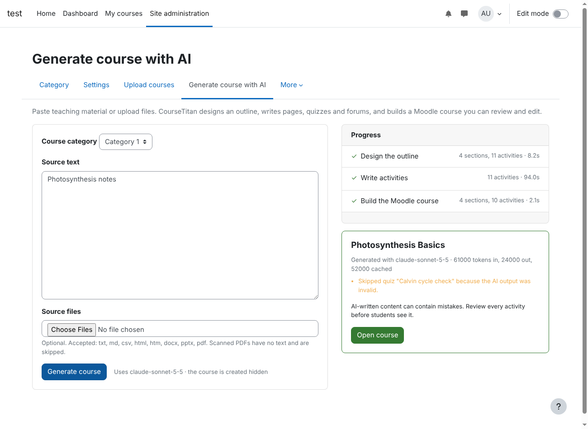
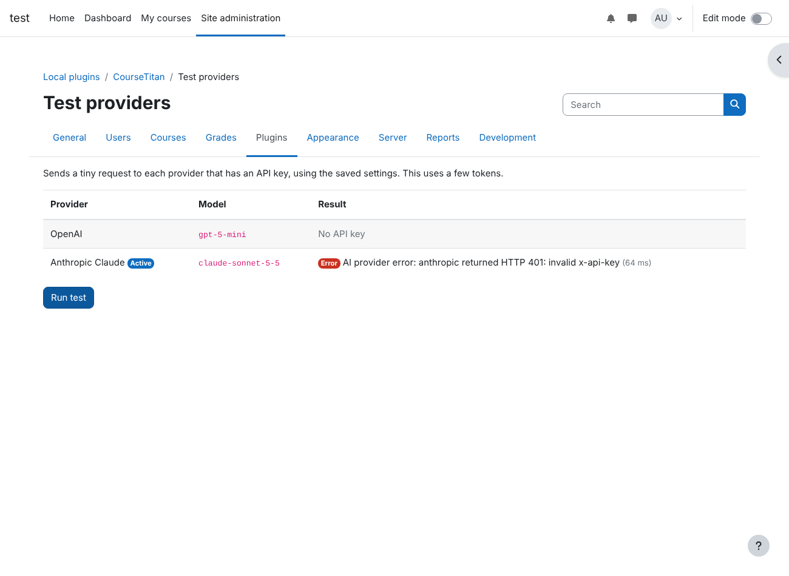

# CourseTitan: AI Course Generator for Moodle

**AI course generator for Moodle. Bring your own OpenAI or Claude key, no middleman.**

[](https://www.gnu.org/licenses/gpl-3.0)
[](https://moodle.org)
[](https://www.php.net)
[](#supported-ai-providers)

CourseTitan is a free, open-source **Moodle plugin that creates complete courses with AI**.
Paste lecture notes or upload a syllabus, Word document, PowerPoint deck or PDF, and CourseTitan
builds a ready-to-review Moodle course with sections, lesson pages, quizzes and discussion forums.

It connects **directly to OpenAI (GPT models) or Anthropic Claude** with your own API key.
There is no third-party service in between, no subscription and no per-course fee. You pay only
for the AI tokens you use, and your teaching material goes straight from your Moodle server to
the AI provider you choose.



## Contents

- [Why CourseTitan](#why-coursetitan)
- [Features](#features)
- [How AI course generation works](#how-ai-course-generation-works)
- [Supported AI providers](#supported-ai-providers)
- [Requirements](#requirements)
- [Installation](#installation)
- [Configuration](#configuration)
- [Who can generate courses](#who-can-generate-courses)
- [Privacy and data handling](#privacy-and-data-handling)
- [Troubleshooting](#troubleshooting)
- [FAQ](#faq)
- [Roadmap](#roadmap)
- [Contributing](#contributing)
- [License](#license)

## Why CourseTitan

Building a Moodle course by hand takes days: structuring topics, writing lessons, drafting quiz
questions and setting up forums. Many AI course creation tools speed this up but route your
content through their own servers and charge per course or per seat.

CourseTitan takes a different approach:

- **No vendor lock-in.** Your API key, your provider, your Moodle server.
- **No middleman.** Requests go directly to OpenAI or Anthropic.
- **Real Moodle activities.** Courses are built with Moodle's own APIs, not imported as a
  backup file, so everything is editable like any course you made yourself.
- **Safe by default.** New courses are hidden from students until a teacher reviews them.

## Features

- **One-click course generation** from text or uploaded files
- **Lesson pages** with headings, lists, tables and worked examples
- **Moodle quizzes** with multiple-choice questions (one correct answer, feedback on every
  option) and true/false questions, added to the question bank and ready to attempt
- **Discussion forums** with a clear task for learners
- **Multiple source formats:** `.txt`, `.md`, `.csv`, `.html`, `.docx` (Word), `.pptx`
  (PowerPoint) and text-based `.pdf`
- **Writes in your source's language** by default, or follows standing instructions you set
  (language, tone, audience, curriculum standards)
- **Live progress** while the outline, activities and course are built
- **Reliable structured output:** every AI response must match a JSON Schema, enforced by the
  provider, then checked for quality before anything is created
- **Automatic repair:** if the AI returns an invalid quiz or page, it gets one chance to fix it;
  anything still broken is skipped and reported, never half-created
- **Prompt caching** keeps costs down when a course has many activities
- **HTML sanitising** of all AI-written content with Moodle's built-in purifier
- **Connection tester** for checking API keys and models from the admin panel
- **Privacy API compliant**, with no personal data stored by the plugin

## How AI course generation works

CourseTitan uses a two-stage pipeline that mirrors how an instructional designer works:

1. **Design the outline.** One AI request reads your material and plans the course title,
   sections and the activities in each section.
2. **Write the activities.** One request per activity writes the lesson page, quiz questions
   or forum task, using the outline for context.
3. **Build the Moodle course.** CourseTitan creates the course, names the sections, adds pages,
   forums and quizzes, and saves quiz questions to the question bank.

Every response is constrained by a fixed JSON Schema (see `classes/schema.php`), enforced natively
by the AI provider: OpenAI Structured Outputs and Claude structured outputs. A validator
(`classes/validator.php`) then checks the rules a schema cannot express, such as exactly one
correct answer per question, a minimum number of questions and real page content.

## Supported AI providers

| Provider | Default model | Notes |
|----------|---------------|-------|
| **OpenAI** | `gpt-5-mini` | Any model that supports Structured Outputs (`json_schema`) |
| **Anthropic Claude** | `claude-sonnet-5-5` | Any Claude model that supports structured outputs |

You can store keys for both providers and switch between them in one setting. Model names are
free text, so you can move to newer models without updating the plugin.

## Requirements

- **Moodle 4.2 or later** (tested on Moodle 4.5)
- **PHP 8.0 or later** with the `curl`, `zip`, `mbstring` and `dom` extensions
- An **OpenAI API key** or an **Anthropic API key**
- Outbound HTTPS from your Moodle server to `api.openai.com` and/or `api.anthropic.com`

## Installation

**From a ZIP file**

1. Download the latest release ZIP.
2. In Moodle, go to **Site administration → Plugins → Install plugins** and upload the ZIP.
3. Follow the on-screen upgrade steps.

**With Git**

```bash
cd /path/to/moodle/local
git clone <this-repository-url> coursetitan
```

Then visit **Site administration → Notifications** to complete the installation.

The PDF parser library is bundled in `vendor/`, so you do not need to run Composer.

## Configuration

Go to **Site administration → Plugins → Local plugins → CourseTitan → Settings**.

| Setting | Default | Description |
|---------|---------|-------------|
| Active provider | OpenAI | Which AI provider generates courses |
| OpenAI API key / model | `gpt-5-mini` | Used when OpenAI is active |
| Anthropic API key / Claude model | `claude-sonnet-5-5` | Used when Claude is active |
| Course category | Category 1 | Default category for new courses |
| Make new courses visible | Off | Keep generated courses hidden until reviewed |
| Max sections | 6 | Upper limit on course sections |
| Max activities per section | 4 | Pages, quizzes and forums per section |
| Questions per quiz | 5 | Questions written for each quiz |
| Standing instructions | empty | Added to every generation, e.g. language or audience |
| Max output tokens | 16000 | Per AI response |
| Request timeout | 300 s | Per AI response |

After saving, open **CourseTitan → Test providers** to send a small test request to each
configured provider.



## Who can generate courses

CourseTitan adds the capability `local/coursetitan:generate`, granted by default to the
**Manager** and **Course creator** roles. Users also need `moodle/course:create` in the target
category.

- **Admins and managers:** Site administration → Courses → Generate course with AI
- **Category course creators:** the category's **More → Generate course with AI** menu

## Privacy and data handling

- CourseTitan stores **no personal data**.
- Source text and extracted file content are sent **only** to the AI provider you select, using
  your own API key. Your provider's data policies apply.
- External data flows are declared through Moodle's **Privacy API**.

## Troubleshooting

| Problem | Solution |
|---------|----------|
| "Moodle blocked the request" | Check **Site administration → General → Security → HTTP security** (cURL blocked hosts, allowed port 443) and server DNS |
| HTTP 401 | The API key is wrong or revoked |
| HTTP 400 mentioning schema or response format | The model does not support structured outputs; choose a newer model |
| "Output was cut off at the token limit" | Increase **Max output tokens** |
| Progress only appears at the end | Your web server is buffering responses. On Apache, disable compression for `/local/coursetitan/stream.php`; nginx is handled automatically |
| A PDF produces no text | It is a scanned image. Export a text-based PDF instead |

## FAQ

**Is CourseTitan free?**
Yes. The plugin is free and open source under the GPL v3. You only pay your AI provider for usage.

**Does it work with ChatGPT?**
It uses the OpenAI API, which serves the same GPT models behind ChatGPT. You need an API key
from the OpenAI platform; a ChatGPT subscription is not an API key.

**Can I use Claude instead of OpenAI?**
Yes. Add an Anthropic API key and choose Anthropic Claude as the active provider.

**Will students see AI-generated content straight away?**
No. Generated courses are hidden by default. Teachers should review and edit every activity
before making the course visible.

**What languages are supported?**
CourseTitan writes in the language of your source material, unless your standing instructions
say otherwise. Quality depends on the AI model you choose.

**Does it create SCORM packages or H5P?**
Not yet. CourseTitan creates native Moodle pages, quizzes and forums.

**Is my content used to train AI models?**
That depends on your AI provider's API terms. CourseTitan itself does not store or share your
content.

**Which Moodle versions are supported?**
Moodle 4.2 and later. It has been tested on Moodle 4.5.

## Roadmap

- More activity types: Lesson, Feedback and Choice
- Optional AI-generated images
- Additional providers (Google Gemini, Azure OpenAI, local models via an OpenAI-compatible API)
- Regenerate a single activity from the course page

Ideas and feature requests are welcome in the issue tracker.

## Contributing

Bug reports, translations and pull requests are welcome. Please follow the
[Moodle coding style](https://moodledev.io/general/development/policies/codingstyle) and include
PHPUnit tests where possible:

```bash
vendor/bin/phpunit --testsuite local_coursetitan_testsuite
```

## License

CourseTitan is licensed under the **GNU General Public License v3.0 or later**. See `LICENSE`.

Bundled third-party libraries are listed in `thirdpartylibs.xml`:
[smalot/pdfparser](https://github.com/smalot/pdfparser) (LGPL 3) and
[symfony/polyfill-mbstring](https://github.com/symfony/polyfill-mbstring) (MIT).

---

Built by **[JustAddWater](https://justaddwater.in)**, Moodle and eLearning specialists.
Need custom Moodle development, AI integrations or LMS consulting? [Get in touch](https://justaddwater.in).

**Keywords:** Moodle AI plugin, AI course generator, AI course creator for Moodle, Moodle course
builder, generate Moodle quizzes with AI, OpenAI Moodle plugin, Claude Moodle plugin, GPT course
generator, LMS AI, eLearning content generation, automatic course creation, instructional design AI.
